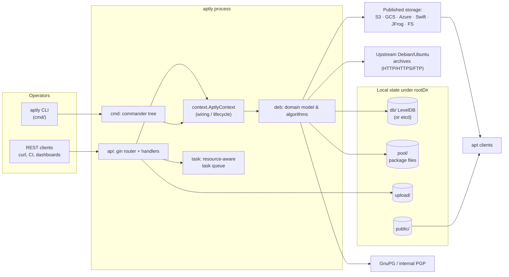

# 2. Architecture

## 2.1 System context



## 2.2 Layered view

aptly is a single Go module (`github.com/aptly-dev/aptly`, `go 1.26`) producing a single
static binary. Its packages form clean layers; arrows below point from a package to what it
depends on.

```
┌───────────────────────────────────────────────────────────────────────────┐
│ main.go   (embeds VERSION and debian/aptly.conf, calls cmd.Run)           │
├───────────────────────────────────────────────────────────────────────────┤
│ cmd/   CLI commands (commander)          api/   REST handlers (gin)        │
├───────────────────────────────────────────────────────────────────────────┤
│ context/   AptlyContext: config, DB, pool, storages, downloader, signer   │
│ task/      task list, resource locking, task output                        │
├───────────────────────────────────────────────────────────────────────────┤
│ deb/   domain: Package, PackageList, PackageRefList, RemoteRepo,           │
│        LocalRepo, Snapshot, PublishedRepo, collections, index files,       │
│        Changes, query engine, dependency & version logic                   │
│ query/ parser for the package query language → deb.PackageQuery            │
├───────────────────────────────────────────────────────────────────────────┤
│ aptly/ interfaces: PackagePool, PublishedStorage, Downloader, Progress,   │
│        ChecksumStorage, PublishedStorageProvider                           │
├───────────────────────────────────────────────────────────────────────────┤
│ Implementations of the interfaces                                          │
│  database/{goleveldb,etcddb}   files/ (fs pool + fs publish)               │
│  s3/ gcs/ azure/ swift/ jfrog/ (publish; azure also pool)                  │
│  http/ (downloader)   pgp/ (signer/verifier)   console/ (progress)         │
├───────────────────────────────────────────────────────────────────────────┤
│ utils/  config, checksums, compression, logging, small helpers             │
│ systemd/activation  socket activation for `api serve`                      │
└───────────────────────────────────────────────────────────────────────────┘
```

### Package responsibilities

| Package | Key files | Responsibility |
|---------|-----------|----------------|
| `main` | `main.go` | Embeds `VERSION` and `debian/aptly.conf` (default config template); `os.Exit(cmd.Run(...))` |
| `cmd` | `cmd.go`, `run.go`, `mirror_*.go`, `repo_*.go`, `snapshot_*.go`, `publish_*.go`, `db_*.go`, `serve.go`, `api_serve.go`, `task_run.go`, `graph.go` … | One file per (sub)command; builds the `commander` tree; parses flags; calls into `deb`/`context` |
| `context` | `context.go` | `AptlyContext`: lazy singletons for config, DB, pool, published storages, downloader, progress, task list, GPG signer/verifier; signal handling; shutdown |
| `api` | `router.go`, `api.go`, `repos.go`, `mirror.go`, `snapshot.go`, `publish.go`, `files.go`, `packages.go`, `db.go`, `task.go`, `gpg.go`, `graph.go`, `s3.go`, `gcs.go`, `jfrog.go`, `storage.go`, `metrics.go`, `middleware.go`, `error.go` | HTTP handlers, request structs (with swagger annotations), sync/async task wrappers |
| `task` | `list.go`, `task.go`, `resources.go`, `output.go` | Background task queue with **resource-based mutual exclusion** |
| `deb` | see §2.4 | Everything Debian-specific and all repository logic |
| `query` | `lex.go`, `syntax.go`, `query.go` | Lexer and recursive-descent parser for query strings |
| `aptly` | `interfaces.go`, `conf.go`, `const.go`, `report.go`, `version.go` | Backend-neutral interfaces & globals (`Version`, `AptlyConf`, `EnableDebug`) |
| `database` | `database.go` + `goleveldb/`, `etcddb/` | KV `Storage` abstraction; two implementations |
| `files` | `package_pool.go`, `public.go` | Local filesystem pool + local filesystem published storage |
| `s3`, `gcs`, `azure`, `swift`, `jfrog` | `public.go`, plus `package_pool.go` in `azure` | Cloud publish targets; Azure can also host the pool |
| `http` | `download.go`, `grab.go`, `compression.go`, `temp.go`, `gcp_auth.go`, `fake.go` | Downloaders (default & grab), "try .xz/.bz2/.gz" logic, `ar+https` GCP Artifact Registry auth |
| `pgp` | `gnupg.go`, `internal.go`, `openpgp.go`, `gnupg_finder.go` | `Signer`/`Verifier` implemented via external `gpg` or pure Go |
| `console` | `progress.go` | Terminal `aptly.Progress` with bars and coloured output |
| `utils` | `config.go`, `checksum.go`, `compress.go`, `copyfile.go`, `logging.go`, `human.go`, `list.go`, `utils.go` | Shared helpers |
| `systemd/activation` | `listeners.go`, `files.go`, `packetconns.go` | Socket-activation helper used by `aptly api serve` |
| `docs` | `index.go`, `*.md`, generated `docs.go`/`swagger.*` | Swagger sources and embedded docs page |

## 2.3 Dependency inversion: the `aptly` interfaces

The `aptly` package (`aptly/interfaces.go`) is the seam that keeps the domain code
storage-agnostic. `deb` depends **only** on these interfaces:

```go
type PackagePool interface {          // where package *files* live
    Verify(...) ; Import(...) ; LegacyPath(...) ; Size(...) ; Open(...)
    FilepathList(...) ; Remove(...)
}
type LocalPackagePool interface {     // optional capability: pool is on a local FS
    Stat ; GenerateTempPath ; Link ; Symlink ; FullPath
}
type PublishedStorage interface {     // where the *published tree* lives
    MkDir ; PutFile ; RemoveDirs ; Remove ; LinkFromPool ; Filelist
    RenameFile ; SymLink ; HardLink ; FileExists ; ReadLink
}
type PublishedStorageProvider interface { GetPublishedStorage(name string) (PublishedStorage, error) }
type Downloader interface { Download ; DownloadWithChecksum ; GetProgress ; GetLength }
type Progress interface { … bars + Printf/ColoredPrintf … }
type ChecksumStorage interface { Get(path) ; Update(path, *ChecksumInfo) }
```

Consequences:

* Adding a new publish target means implementing `PublishedStorage` (see
  [Development](13-development.md#add-a-published-storage-backend)).
* The Azure pool implements `PackagePool` but **not** `LocalPackagePool`, so hard-linking or
  symlinking pool files into a published tree is impossible; `LinkFromPool` then must
  copy/upload (`files.PublishedStorage.LinkFromPool` errors with *"cannot link … from
  non-local pool"* unless `link_method: copy`).
* `Progress` lets the same algorithm run with a terminal progress bar (CLI) or a buffered
  text log (`task.Output`, REST) — see [chapter 7](07-rest-api-and-tasks.md).
* `AptlyContext` itself implements `PublishedStorageProvider`, so `deb.PublishedRepo.Publish`
  can lazily obtain the storage named in its `Storage` field (`""`, `filesystem:x`,
  `s3:x`, `gcs:x`, `swift:x`, `azure:x`, `jfrog:x`).

## 2.4 The `deb` package (the heart)

| Concept | File(s) | Notes |
|---------|---------|-------|
| Parsing of RFC-822-like control data | `format.go` | `Stanza`, `ControlFileReader`; canonical field ordering when writing |
| `Package` | `package.go`, `package_files.go`, `package_deps.go`, `package_collection.go` | In-memory model with lazy "offloaded" fields; `PackageCollection` persists them |
| `PackageList` | `list.go` | In-memory set of packages, indexed for search, dependency verification, filter |
| `PackageRefList` | `reflist.go` | Sorted `[][]byte` of package keys; Diff/Merge/Subtract; msgpack-encoded |
| Mirror | `remote.go`, `ppa.go` | `RemoteRepo` + `RemoteRepoCollection`; index download & parsing; `ppa:` URL expansion |
| Local repo | `local.go`, `import.go`, `changes.go`, `uploaders.go` | `LocalRepo`; file collection/import; `.changes` handling; uploader ACL rules |
| Snapshot | `snapshot.go` | `Snapshot` + `SnapshotCollection` |
| Publication | `publish.go`, `index_files.go`, `contents.go` | `PublishedRepo` and `Publish()`; generation/signing/atomic rename of index files; contents index |
| Query engine | `query.go` | `PackageQuery` implementations (`AndQuery`, `OrQuery`, `NotQuery`, `FieldQuery`, `DependencyQuery`, `PkgQuery`, `MatchAllQuery`) |
| Version/deps | `version.go`, `package_deps.go` | Debian version comparison, dependency parsing |
| Factory | `collections.go` | `CollectionFactory` hands out one collection per type over a shared DB |
| Misc | `graph.go`, `find_dangling.go`, `checksum_collection.go`, `debian.go`, `deb.go` | Graphviz export, dangling-ref detection, checksum cache, `.deb`/`.dsc` readers |

### Collections pattern

Each persistent type has a `*Collection` (e.g. `SnapshotCollection`) taking a
`database.Storage`. A collection offers `Add`, `Update`, `Drop`, `ByName`, `ByUUID`,
`ForEach`, `Len`, and — importantly — `LoadComplete`. Objects are loaded **shallow**
(metadata only, cheap) and their `PackageRefList` is fetched from a separate key only when
`LoadComplete` is called. This keeps `aptly snapshot list` fast even with huge snapshots.

`CollectionFactory` (`deb/collections.go`) is created once per command/request and caches
one instance of each collection, guarded by a mutex. `Flush()` drops them to reclaim memory.

> **Lock order.** `api/api.go` documents the canonical acquisition order for collections to
> avoid deadlocks: `RemoteRepoCollection → LocalRepoCollection → SnapshotCollection →
> PublishedRepoCollection`.

## 2.5 Runtime modes

| Mode | Entry | Process model | DB handling |
|------|-------|---------------|-------------|
| **CLI batch** | `aptly <cmd> …` | One process per command | Opens LevelDB (exclusive file lock) on first use; closes on exit. Long operations (mirror update) *close* the DB during downloading so other commands can run |
| **API server** | `aptly api serve -listen=:8080` | Long-lived HTTP server (gin); mutating requests run as tasks | DB stays open for the life of the server. With `-no-lock` the server closes the DB whenever there are zero in-flight requests |
| **Static file server** | `aptly serve -listen=:8080` | Long-lived; serves `rootDir/public` (and prints recommended `sources.list` lines) | Read-only lookup of published repos at start |
| **Task script** | `aptly task run -filename=cmds.txt` or stdin | Runs many aptly commands in a single process (one DB open) | Avoids repeated open/close cost |
| **Systemd-managed API** | `debian/aptly-api.service` | Runs `aptly api serve -config=/etc/aptly.conf … -listen=…` as user `aptly-api`. `aptly api serve` can also adopt a single listener fd passed by systemd socket activation (`systemd/activation`) | Same as API server |

## 2.6 Concurrency model

* **CLI**: essentially single-threaded orchestration; parallelism is confined to
  * package downloading (`download_concurrency` goroutines in `cmd/mirror_update.go`),
  * filesystem walking (`saracen/walker`),
  * compression (`klauspost/pgzip`).
* **API**: gin serves each HTTP request in its own goroutine, but every operation that
  mutates state is wrapped in a **task** (`task.List`). Tasks declare the *resources* they
  need (e.g. the key of a local repo `"L<uuid>"`); the list guarantees no two tasks with
  intersecting resources run concurrently, and special keys
  `__all__` / `__alllocalrepos__` express "everything"/"all local repos". See
  [chapter 7](07-rest-api-and-tasks.md#73-the-task-system).
* **Database**: LevelDB is safe for concurrent goroutines inside one process. Cross-process
  safety is provided by the LevelDB file lock ("resource temporarily unavailable" ⇒ retry with
  jittered ~10 s sleeps up to `database_open_attempts`).
* **Mirror update guard**: a `RemoteRepo` records `Status` and `WorkerPID` in the DB;
  `CheckLock()` refuses a second update when that PID is alive (override: `-force`).

## 2.7 Cross-cutting concerns

| Concern | Where | Behaviour |
|---------|-------|-----------|
| Configuration | `utils/config.go`, `context.config()` | YAML or JSON (with comments). Search order: `-config` flag, `~/.aptly.conf`, `/usr/local/etc/aptly.conf`, `/etc/aptly.conf`. If none found, a default (the embedded `debian/aptly.conf`) is written to `~/.aptly.conf` |
| Logging | `utils/logging.go` (zerolog) | `log_level`, `log_format: default|json`; JSON mode also makes gin log JSON (`api.JSONLogger`) |
| Error handling (CLI) | `context.Fatal` | Commands return `error`; `cmd.Run` converts to exit code 1 (2 for usage errors) via a panic/recover on `FatalError` |
| Error handling (API) | `api.AbortWithJSONError` | Sets JSON content type and aborts with status; gin's `ErrorLogger` middleware renders `{"error": "..."}` |
| Metrics | `api/metrics.go` | Prometheus counters/gauges/histograms (opt-in `enable_metrics_endpoint`) incl. per-repo package counts |
| Signals | `context.GoContextHandleSignals`, `cmd/api_serve.go` | First `^C` cancels the Go context (downloads stop, cleanup runs); second `^C` aborts immediately. API server waits for running tasks before shutdown |
| Reproducible builds | `deb/publish.go` | `SOURCE_DATE_EPOCH` env var overrides `Date:` in the top-level `Release` file |
| Debug tooling | `aptly/version.go` (`const EnableDebug`) | Compile-time constant (default `false`); when set to `true` at build time it adds `-cpuprofile`, `-memprofile`, `-memstats`/`-meminterval` flags and gin debug mode |

## 2.8 Key design decisions and their rationale

1. **References, not copies.** `PackageRefList` (sorted list of package keys) makes
   snapshot/merge/diff operations linear merges over sorted byte slices and makes snapshots
   nearly free. The price: deleting data needs a mark-and-sweep GC (`db cleanup`).
2. **Content-addressed pool.** Files are keyed by SHA-256, so identical files from different
   mirrors/versions are stored once, and integrity can be re-verified cheaply. A MD5-keyed
   *legacy* layout (aptly ≤ 1.0) is still read (unless `skip_legacy_pool`).
3. **Package key includes a hash of the file set** (`FilesHash`). Two "same name+version"
   packages with different bytes (e.g. rebuilt without version bump) become *distinct keys*,
   so a snapshot can never silently change content.
4. **Offloaded package fields.** The base `Package` record is small; `Files`, `Depends…` and
   `Extra` are separate keys (`xF`, `xD`, `xE` prefixes). Listing, diffing and merging rarely
   need them, so they are loaded lazily.
5. **Publishing writes to temp names and renames.** Index files are generated in a temp dir,
   uploaded as `*.tmp` when re-publishing, then renamed — minimising the time clients could
   see a half-written state (see [chapter 6](06-publishing.md)).
6. **One codebase, two front-ends.** CLI commands and REST handlers are separate thin
   layers over the same `deb` operations; the REST layer adds tasks, JSON and locking.
7. **Interfaces at every I/O boundary** (DB, pool, published storage, downloader, signer,
   progress) — unit tests inject fakes (`http/fake.go`, `files/mocks.go`, `console`), and new
   back-ends are additive.
8. **Explicit DB open/close.** The CLI can release the LevelDB lock during long network
   phases (`context.CloseDatabase()` / `ReOpenDatabase()`), which is why a mirror update
   collects all download tasks first, closes the DB, downloads, reopens, then imports.

## 2.9 Build & release artefacts

* `go build` → `aptly` binary. `main.go` embeds `VERSION` (generated by `go generate` from
  `make version`, based on `debian/changelog` + git commit for CI builds) and
  `debian/aptly.conf`.
* Debian packaging (`debian/`): packages `aptly` (binary, man page, bash completion),
  `aptly-api` (systemd unit + `/etc/aptly.conf` handling) and `aptly-dbg`.
* `completion.d/` — bash and zsh completions; `man/` + `_man/gen.go` — man page generation from
  command help text.
* `docs/` + `make swagger` — OpenAPI generation via `swag` from handler annotations.
