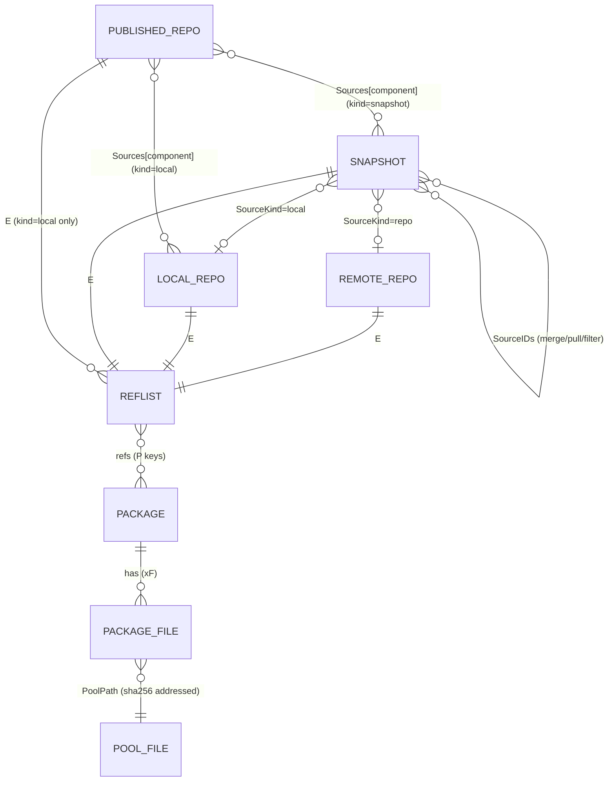

# 3. Data Model & Database

aptly's entire *metadata* state lives in an ordered key/value store. Package *files* do not
(see [chapter 4](04-storage.md)). This chapter describes the key space, value encodings, the
in-memory model built from them, and the storage back-ends.

## 3.1 The KV abstraction (`database/database.go`)

```go
type Storage interface {
    Reader                    // Get(key) ([]byte, error)          → database.ErrNotFound
    Writer                    // Put(key, value) ; Delete(key)
    PrefixReader              // HasPrefix ; ProcessByPrefix ; KeysByPrefix ; FetchByPrefix
    CreateBatch() Batch       // buffered writes, applied by Write()
    OpenTransaction() (Transaction, error)   // Commit() / Discard()
    CreateTemporary() (Storage, error)       // scratch DB of the same type
    Open() ; Close() ; CompactDB() ; Drop()
}
```

Everything else in aptly is expressed using only these operations, notably **prefix scans**
(all snapshots = every key starting with `S`).

### Back-ends

| Backend | Package | Selected by | Notes |
|---------|---------|-------------|-------|
| **LevelDB** (default) | `database/goleveldb` | `database_backend.type: leveldb` (or unset) | Embedded, single-process (exclusive file lock), bloom filter (10 bits), 256 cached open files. Path: `rootDir/db` or `database_backend.db_path`. `Put` skips writing if the value is unchanged. Temporary DBs are created in the OS temp dir with throttled compaction settings (`CompactionL0Trigger=32`, `WriteL0Pause=96`, `WriteL0Slowdown=64`) |
| **etcd** | `database/etcddb` | `database_backend.type: etcd`, `url: host:2379` | Network KV; allows several aptly processes to share state. Message limits raised to ~2 GiB, 30 s dial timeout. Temporary DBs are emulated by a UUID key prefix in the same cluster |

`aptly db recover` (`cmd/db_recover.go`) runs `goleveldb.RecoverDB` to rebuild a corrupted
LevelDB. `system/leveldb2etcd.py` migrates LevelDB → etcd.

## 3.2 Key space

| First byte(s) | Meaning | Key format | Value |
|---------------|---------|-----------|-------|
| `P` | **Package** (core record) | `P<arch> <name> <version> <filesHash8hex>` e.g. `Pamd64 nginx 1.24.0-1 8f3a91c2` | `0xC1 0x01` marker + msgpack(`Package` public fields) |
| `xF` + package key | Package **files** (offloaded) | `xF` + full package key | msgpack(`PackageFiles`) |
| `xD` + package key | Package **dependencies** (offloaded) | `xD` + key | msgpack(`PackageDependencies`: Depends, PreDepends, Suggests, Recommends, Build-Depends…) |
| `xE` + package key | Package **extra** control fields (offloaded) | `xE` + key | msgpack(`Stanza`, i.e. `map[string]string`) |
| `xC` + package key | Cached **contents** (list of file paths in the `.deb`) | `xC` + key | msgpack(`[]string`); computed lazily on first publish with Contents enabled |
| `R` | **Remote repo** (mirror) | `R<uuid>` | msgpack(`RemoteRepo`) — metadata only |
| `L` | **Local repo** | `L<uuid>` | msgpack(`LocalRepo`) |
| `S` | **Snapshot** | `S<uuid>` | msgpack(`Snapshot`) |
| `U` | **Published repo** | `U<storage:prefix>>><distribution>` (`StoragePrefix()` + `">>"` + `Distribution`) | msgpack(`PublishedRepo`) |
| `E` | **Package ref list** for a mirror/local repo/snapshot | `E<uuid>` | msgpack(`PackageRefList{Refs [][]byte}`) |
| `E` (published) | Ref list *frozen at publish time* for a **local-repo** publication | `E<publishedUUID><component>` | msgpack(`PackageRefList`) |
| `C` | **Checksum cache** for pool files | `C<poolPath>` | msgpack(`utils.ChecksumInfo`) |

Notes:

* UUIDs are random v4 (`google/uuid`), assigned at creation; **names are only unique
  indexes** enforced by the collections (renames just rewrite the metadata record).
* Because a ref list key is `E<uuid>` and each mirror/local repo/snapshot has its own UUID,
  the three never collide. Published local-repo ref lists append the component name to
  the published repo's own UUID.
* The `P` scan is what makes "all packages in the DB" cheap: `PackageCollection.AllPackageRefs()`
  is simply `KeysByPrefix("P")` — the very first byte deliberately excludes `xF/xD/xE/xC`
  keys (they start with `x`).
* Published repos are **all loaded into memory** on first use (`PublishedRepoCollection.loadList`)
  because they are few and lookups by *(storage, prefix, distribution)* / by source are
  common.

### Entity relationships



## 3.3 The Package record

```go
type Package struct {
    Name, Version, Architecture string
    SourceArchitecture string   // for source packages: real Architecture: field
    Source             string   // binary → its source package name (+ optional version)
    Provides           []string
    FilesHash          uint64   // FNV-64a over the sorted file list + checksums
    IsInstaller, IsSource, IsUdeb, V06Plus bool
    // offloaded (lazy; not in the core record):
    deps *PackageDependencies ; extra *Stanza ; files *PackageFiles ; contents []string
    collection *PackageCollection
}
```

### Package key

```
P<Architecture> <Name> <Version> <FilesHash as %08x>
```

* `V06Plus == true` (all packages created by aptly ≥ 0.6) includes `FilesHash`; older
  packages use the *short key* `P<arch> <name> <version>`.
* `FilesHash = FNV-64a( for each file sorted by name: filename ‖ size ‖ MD5 ‖ SHA1 ‖ SHA256 )`
  (`deb/package_files.go: PackageFiles.Hash`). Same name/version/arch but different bytes ⇒
  **different key**, so two mirrors can legitimately hold "different" `foo_1.0_amd64`.
* Keys sort lexicographically by architecture, then name, then version-as-string, then hash.
  This ordering is **not** Debian version order; version comparisons use `CompareVersions`.

### Where package data comes from

| Source | Constructor | Notes |
|--------|-------------|-------|
| `Packages` stanza (mirror) | `NewPackageFromControlFile` | Pulls `Filename`, `Size`, `MD5sum`, `SHA1`, `SHA256`, `SHA512`; the `Filename` directory is remembered as `downloadPath` (for download only, not stored) |
| `Sources` stanza (mirror) | `NewSourcePackageFromControlFile` | Parses `Files`, `Checksums-Sha1/256/512`; `Architecture` is set to `source` |
| `.deb` file | `deb/deb.go` `GetControlFileFromDeb` → `NewPackageFromControlFile` | `ar` archive → `control.tar.{gz,xz,zst,…}` → `control` |
| `.udeb` | `NewUdebPackageFromControlFile` | Same but `IsUdeb` |
| `.dsc` | `deb/debian.go` `GetControlFileFromDsc` → source constructor | Also verifies referenced files exist next to it |
| Debian-installer images | `NewInstallerPackageFromControlFile` | Parses the installer `SHA256SUMS` file of a component/architecture and creates one synthetic package named `installer` (`IsInstaller`) whose files are the listed images; file sizes are obtained with `GetLength` (HTTP HEAD). Published under `dists/<dist>/<component>/installer-<arch>/current/images` (`legacy-images` for `focal`) |

### Offloading and lazy loading

`Package.Files()`, `.Deps()`, `.Extra()` and `.Contents()` transparently load their data from
`xF/xD/xE/xC` keys through the `collection` back-pointer the first time they are used. The
publish loop explicitly drops (`pkg.files = nil` …) these after writing each stanza to keep
memory bounded on huge repositories.

### Migration of old databases

`PackageCollection.ByKey` detects the encoding by the `0xC1 0x01` marker:

* Present → current format (msgpack of the split record).
* Absent → aptly < 0.4 "all fields in one struct" (`oldPackage`); it is decoded, converted and
  **immediately rewritten** in the new format.

Similar tolerant decoding exists in `RemoteRepo.Decode` (Go < 1.2 time encoding, codec
`TimeNotBuiltin`) and `PublishedRepo.Decode` (pre-0.6 single `SnapshotUUID`+`Component` fields
→ `Sources` map; default `SourceKind = snapshot`).

## 3.4 PackageRefList — the unit of "repository content"

```go
type PackageRefList struct { Refs [][]byte }   // ALWAYS sorted lexicographically
```

Refs are package keys **without** any prefix other than the leading `P` (`p.Key("")`).
Because the slice is sorted, all set-like operations are linear two-pointer merges:

| Operation | Method | Used by |
|-----------|--------|---------|
| Membership | `Has(p)` — binary search | conflict checks |
| Set difference | `Subtract(r)` | `db cleanup` (all keys − referenced keys) |
| Diff with details | `Diff(r, packageCollection)` | `snapshot diff` (CLI and `GET /api/snapshots/:name/diff/:with`); loads packages to classify entries as *added / removed / changed* |
| Merge | `Merge(r, overrideMatching, ignoreConflicting)` | `snapshot merge`, `db cleanup`, repo add |
| Latest per name | `FilterLatestRefs()` | `snapshot merge -latest` |
| Iterate | `ForEach` | everything |
| Build from list | `NewPackageRefListFromPackageList` | after filtering/pull |

### Merge semantics (`deb/reflist.go: Merge`)

`Merge(l, r, overrideMatching, ignoreConflicting)` walks both lists in key order:

* identical refs → keep one;
* `overrideMatching=true` → when `(arch,name)` is equal on both sides, the **right**
  package replaces the left one ("last wins");
* `ignoreConflicting=false` → same `(arch,name,version)` but different file-hash: the right
  one wins (conflict resolution);
* `ignoreConflicting=true, overrideMatching=false` → keep everything, a plain union.

Callers: `snapshot merge` calls `Merge(right, overrideMatching, false)` with
`overrideMatching = !latest && !no-remove`, and afterwards calls `FilterLatestRefs()` for
`-latest` (`-latest` and `-no-remove` are mutually exclusive). `db cleanup` calls
`Merge(refs, false, true)` to build the union of all referenced packages. The API snapshot
create/pull handlers use `Merge(…, true, false)`.

### Encoding

`Encode()` → msgpack via `ugorji/go/codec` (`MsgpackHandle`). `Decode()` enables the codec's `ZeroCopy`
option, so decoded refs may alias the input buffer rather than copying it.

## 3.5 PackageList — the in-memory working set

`PackageList` (`deb/list.go`) is a **map** `key → *Package` plus optional indexes:

* `packagesIndex` — packages sorted by name ascending, then version **descending** (newest first,
  via `CompareVersions`), then architecture, for binary search (`PrepareIndex()`; required before
  `Search/Filter`);
* `providesIndex` — virtual package name → providers.

Two key functions exist: the *short key* (no file hash) prevents adding two packages of the
same name/version/arch — a `PackageConflictError` is returned (mirror update logs
"skipping package … duplicate in packages index"); the *full key* variant
(`NewPackageListWithDuplicates(true, …)`) allows duplicates.

Typical life: `NewPackageListFromRefList(reflist, packageCollection, progress)` loads every
referenced `Package` from the DB (progress bar `BarGeneralBuildPackageList`), then callers
`PrepareIndex()`, `Filter`, `Search`, `VerifyDependencies`, `ForEachIndexed`,
`Append`, `Remove`…

## 3.6 The persisted entities

### RemoteRepo (`R…`)

`UUID, Name, ArchiveRoot, Distribution, Components[], Architectures[], Meta (Release fields),
LastDownloadDate, ReleaseFiles (map path → ChecksumInfo), Filter, FilterWithDeps,
Status (idle/updating), WorkerPID, SkipComponentCheck, SkipArchitectureCheck,
DownloadSources, DownloadUdebs, DownloadInstaller, DownloadAppStream, AppStreamFiles`.
Ref list under `E<uuid>`. *Flat* repositories (distribution ending in `/` or starting with
`.`) are detected in `NewRemoteRepo` and have no components.

### LocalRepo (`L…`)

`UUID, Name, Comment, DefaultDistribution, DefaultComponent, Uploaders (json ACL)`; ref list
`E<uuid>`.

### Snapshot (`S…`)

`UUID, Name, CreatedAt, SourceKind ("repo"|"local"|"snapshot"), SourceIDs[], Description,
Origin, NotAutomatic, ButAutomaticUpgrades, AppStreamFiles`; ref list `E<uuid>`.
Snapshots are immutable by convention: the only mutating operations are **rename** and
**description edit**. Provenance (`SourceKind`+`SourceIDs`) forms a DAG that
`aptly graph` (Graphviz) and `walkUpTree` (used to infer default distribution/component)
traverse.

### PublishedRepo (`U…`)

```
UUID, Storage, Prefix, Distribution,
Origin, NotAutomatic, ButAutomaticUpgrades, Label, Suite, Codename, Version,
Architectures[], SourceKind ("snapshot"|"local"),
Sources: map[component]sourceUUID,
SkipContents, SkipBz2, AcquireByHash, SignedBy, MultiDist,
Revision {Sources: map[component]name}      // staged, not-yet-applied source changes
```

* `(Storage, Prefix, Distribution)` must be unique (`CheckDuplicate`).
* For `SourceKind == "local"` the *ref list is copied* at publish time into
  `E<publishedUUID><component>`; the publication therefore represents the local repo **as of
  publish time** and only changes on `publish update`.
* `Revision` implements the "`publish source add/remove/update/…`" staging workflow: edit the
  set of sources first, then apply them with `publish update`
  (`PublishedRepo.Update` consumes/`DropRevision`s it).

### Checksum cache (`C<poolPath>`)

Pool files are validated against their DB-cached checksums rather than re-hashed on every
run. `ChecksumCollection` implements `aptly.ChecksumStorage`; `PackagePool.ensureChecksums`
fills it on demand.

## 3.7 Transactions, batches, and consistency

* **Package writes** use a transaction (`PackageCollection.Update` /
  `UpdateInTransaction`) so the four keys of a package (`P`, `xF`, `xD`, `xE`) are atomic.
  Mirror update opens **one transaction for the whole package set** in `FinalizeDownload`
  (see [chapter 5](05-workflows.md#51-mirror-update)).
* **Entity + ref list** writes use a `Batch` (`collection.Update` → `Put(Key) ; Put(RefKey)`),
  applied atomically by LevelDB's write batch.
* There is **no cross-entity transaction**: e.g. dropping a snapshot deletes `S…` and
  `E…` in one batch, but the "is it published?" check is a prior read. In the API this is
  protected by task resource locks, in the CLI by the process-exclusive DB lock.
* Referential integrity is **soft**: a snapshot references package keys that must exist.
  `aptly db cleanup` never deletes a package referenced by any mirror, local repo, snapshot
  or local-repo publication. The reverse problem — refs pointing to packages that no longer exist —
  is repaired for **local repos** by `aptly db recover` (`deb/find_dangling.go`,
  `FindDanglingReferences` → the refs are removed from the repo).

## 3.8 Performance characteristics

* A package record is small (core) plus a few KB of offloaded fields; a snapshot of N packages
  costs on the order of N short keys, not N packages.
* Loading a ref list into a `PackageList` reads every referenced package from the DB (several
  Gets per package) — this is the dominant cost of `snapshot merge/pull/filter` and `publish`,
  and the reason those operations show progress bars. Ref-only operations (`Merge`,
  `Subtract`, `Has`) never touch package records.
* Sizes vary with the mirror (long `Description` fields make the `xE` records the largest part
  of the DB); measure your own mirrors with `du -sh $rootDir/db $rootDir/pool`.
