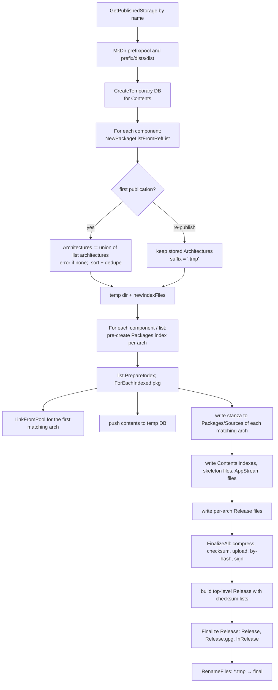

# 6. Publishing Internals

Publishing turns "a list of package refs per component" into a directory tree that `apt` can
consume. Implemented by `PublishedRepo.Publish` (`deb/publish.go`), `indexFiles`/`indexFile`
(`deb/index_files.go`) and `ContentsIndex` (`deb/contents.go`).

## 6.1 Inputs and outputs

**Inputs** (all in the `PublishedRepo`):

* `Storage`, `Prefix`, `Distribution`;
* one source per **component** (`sourceItems[component]` → snapshot or local repo, with
  its `PackageRefList`);
* metadata: `Origin`, `Label`, `Suite`, `Codename`, `Version`, `NotAutomatic`,
  `ButAutomaticUpgrades`, `SignedBy`, `Architectures`;
* switches: `SkipContents`, `SkipBz2`, `AcquireByHash`, `MultiDist`, `rePublishing` (internal);
* collaborators: `PackagePool`, `PublishedStorageProvider`, `CollectionFactory`,
  `pgp.Signer` (nil = unsigned), `Progress`, `forceOverwrite`, `skelDir`.

**Outputs** on the published storage: the tree in [§4.6](04-storage.md#46-where-files-end-up-in-a-published-tree).

## 6.2 The algorithm, step by step

`Publish()` (annotated with the sub-steps in the source):



### Step details

1. **Storage & directories.** `publishedStorage.MkDir(prefix/pool)` and `…/dists/<dist>` (no-ops
   on object stores).
2. **Temporary DB.** `collectionFactory.TemporaryDB()` (a scratch LevelDB, or a prefixed keyspace
   in etcd) holds the *contents index* while packages stream through. Closed **and dropped** in a
   `defer`.
3. **Load packages.** `NewPackageListFromRefList(p.RefList(component), PackageCollection, progress)`
   per component — this is the heavy I/O phase ("Loading packages…").
4. **Architectures.** On first publish, if none were specified, the union of
   `list.Architectures(true)` (including `source`) over all components; empty ⇒ *"unable to figure
   out list of architectures, please supply explicit list"*. Sorted, de-duplicated. On re-publish
   the stored list is kept (so an emptied source can't erase architectures).
5. **Index writers.** `newIndexFiles(storage, basePath=prefix/dists/dist, tempDir, suffix,
   acquireByHash, skipBz2)`; `suffix = ".tmp"` when re-publishing.
6. **Per component, per architecture:** `indexes.PackageIndex(component, arch, false, false,
   dist)` pre-registers `Packages` files so **empty** architectures still get a file.
7. **Per package** (`list.ForEachIndexed` — sorted by name, version descending, arch):
   * For the **first architecture that the package matches** (`MatchesArchitecture`: an
     `Architecture: all` package matches every architecture except `source`; everything else
     requires equality — source packages have architecture `source`)
     compute the pool-relative directory:
     * normal: `pool/<component>/<PoolDirectory>` (`PoolDirectory` = `l/libfoo` or `f/foo`);
     * `MultiDist`: `pool/<distribution>/<component>/<PoolDirectory>`;
     * installer packages: `dists/<dist>/<component>/installer-<arch>/current/images`
       (`legacy-images` when distribution is `focal`),
     and call `pkg.LinkFromPool(publishedStorage, packagePool, prefix, relPath, forceOverwrite)`
     which, for each `PackageFile`, calls `publishedStorage.LinkFromPool(...)`. It happens once
     per package, not once per architecture.
   * Open a DB **batch** on the temp DB. For **each matching architecture**:
     * unless `SkipContents` or installer: compute `pkg.Contents(pool, progress)` — reads the
       `.deb` from the pool, extracts the file list from `data.tar.*`, and caches it in
       `xC<key>` (persistent, reused by later publishes); push `(path, qualifiedName)` pairs
       into two `ContentsIndex`es: per-component-per-arch and the *legacy* global one;
     * append `pkg.Stanza()` to that architecture's `Packages`/`Sources` writer followed by a
       blank line. The stanza contains extra control fields (`xE`), dependencies (`xD`), pool
       `Filename:` (`pool/<component>/…/<file>`), `Size`, `MD5sum`, `SHA1`, `SHA256`, `SHA512`
       (`xF`), in canonical Debian field order (`format.go: canonicalCase` + order table).
   * Free `files/deps/extra/contents` of the package immediately (bounded memory) and flush the
     batch.
8. **Contents.** After all packages: for every arch × {deb,udeb} with a non-empty index, write
   `<component>/Contents-<arch>[.gz]` (`FILE LOCATION` header, sorted paths, comma-joined
   qualified names, gzip only) and, after all components, the legacy top-level
   `Contents-<arch>.gz` / `Contents-udeb-<arch>.gz` covering *all* components.
   `ContentsIndex.WriteTo` scans the temp DB in key order, merging consecutive keys with the
   same path — key layout is `uuidPrefix ‖ path ‖ 0x00 ‖ qualifiedName`.
9. **Skeleton files** (`rootDir/skel/<prefix>/dists/<dist>/<component>/…`): arbitrary
   operator-provided files copied verbatim into the component directory.
10. **AppStream (DEP-11)**: for snapshots with `AppStreamFiles`, files for the matching
    component are copied out of the *package pool* into
    `<component>/dep11/…` (mirrors made with `-with-appstream`).
11. **Per-arch Release** (`<component>/binary-<arch>/Release`, `source/Release`): tiny stanza
    with `Archive`, `Architecture`, `Component`, `Origin`, `Label`, `Suite`, `Codename`, and optionally
    `Acquire-By-Hash`, `Signed-By`, `Version`. Created for udebs only if `hadUdebs`.
12. **FinalizeAll** (`indexFile.Finalize` for every registered file):
    * flush; if `compressable`, compress to `.gz` and `.bz2` (`utils.CompressFile` with
      `pgzip`; `.bz2` skipped with `SkipBz2`; the legacy Contents are gzip only);
    * compute **MD5, SHA-1, SHA-256, SHA-512, size** for the plain and each compressed
      variant → stored in `generatedFiles[path]` (used for the top-level Release);
    * `MkDir` the directory; if `acquireByHash`, ensure `by-hash/{MD5Sum,SHA1,SHA256,SHA512}`;
    * `PutFile` each variant to `<path><suffix><ext>` (i.e. `Packages.tmp`, `Packages.gz.tmp` when
      re-publishing) and record `renameMap[tmp] = final`;
    * `acquireByHash` → `packageIndexByHash` hard-links the just-uploaded file to
      `by-hash/<HASH>/<digest>` (if not yet present), keeps the previous index as
      `<name>.old` symlink, deletes the *older* physical file, and repoints `<name>` → new digest;
    * installer `SHA256SUMS` are **detach-signed** (`.gpg`).
13. **Top-level `Release`** (`dists/<dist>/Release`):
    ```
    Origin, [NotAutomatic], [ButAutomaticUpgrades], Label, Suite, Codename,
    Date: <UTC now, or SOURCE_DATE_EPOCH>,
    Architectures: <all non-source architectures>,
    [Acquire-By-Hash: yes], [Signed-By: …  + Valid-Until: now+100y], [Version],
    Description:  Generated by aptly,
    Components: <sorted list>,
    MD5Sum:/SHA1:/SHA256:/SHA512: one line per generated file: " <hash> <size> <path>"
    ```
    Paths are sorted; sizes right-aligned in 8 characters.
14. **Sign Release.** `releaseFile.Finalize(signer)` writes `Release`, detached `Release.gpg`
    and clearsigned `InRelease` (`detachedSign` and `clearSign` both true for the top-level file).
    If `signer == nil` these are skipped and clients need `[trusted=yes]` or
    `allow-insecure`.
15. **Swap in.** `indexes.RenameFiles()` renames every `*.tmp` to its final name (only when
    re-publishing; first publication wrote final names directly).

### The consistency window

Re-publishing is *not* a transactional swap. The new index files are uploaded first under
`.tmp` names, but `RenameFiles` iterates the rename map (a Go map — **order unspecified**) and each
rename is separate. On a filesystem, `rename(2)` is atomic per file, so a client sees, at any
instant, some mix of new and old index files; a mismatch between `Release` checksums and a
`Packages.gz` can produce apt's *"Hash Sum mismatch"* error for clients updating in that
moment. Mitigations:

* enable **`-acquire-by-hash`** so clients fetch immutable, content-addressed copies;
* keep the window short (index files are small; package files are already linked before);
* put the published tree behind a proxy/CDN with consistent-snapshot semantics or
  publish to a new prefix and switch a symlink/DNS.

## 6.3 Package files: link, copy or upload

`LinkFromPool` is called **before** the index that references the file is visible, so clients
never see a stanza pointing at a missing file. Behaviour by target:

| Target | What happens | Idempotency check |
|--------|--------------|------------------|
| Filesystem + `hardlink` | `link(2)` pool file → published path | same inode & device |
| Filesystem + `symlink` | `symlink` → absolute pool path | same inode & device of resolved target |
| Filesystem + `copy` | stream + `fsync` | size or MD5 (`verify_method`) |
| S3 / GCS / Azure / Swift / JFrog | upload stream | MD5 vs cached/remote MD5 |

When two publications (same storage+prefix) contain the *same file* they link to the same
destination; the idempotency check makes that a no-op. If two **different** files would land
on the same published path (same source name & filename, different bytes — legal in Debian archives
that reuse `orig` tarball names across distributions), the second publish fails with *"file
already exists and is different"* — use `-force-overwrite` (dangerous: it can break the other
publication) or, better, **`-multi-dist`** to isolate pools per distribution.

## 6.4 What is regenerated when

| Command | Package lists reloaded | Index files rewritten | Pool linking | Cleanup |
|---------|-----------------------|-----------------------|--------------|---------|
| `publish snapshot/repo` | all components | all | all files | none |
| `publish switch` | all components (after replacing chosen sources) | all | all files (already-linked = no-op) | orphaned pool files of changed components |
| `publish update` (local repo) | all components (fresh ref lists) | all | all files | orphaned files of updated/removed components |
| `publish update` with staged sources | same | all | all | affected components |
| `publish drop` | — | removed | removed | see §4.7 |

There is **no incremental index generation**: even a one-package change re-emits every `Packages`
file. The costs are dominated by package loading and gzip/bz2 compression; contents are cached
per package (`xC`) so only new packages are re-inspected.

## 6.5 Publishing knobs and their effect

| Option | CLI flag | Config | Effect |
|--------|----------|--------|--------|
| Skip `Contents-*` | `-skip-contents` | `skip_contents_publishing` | Saves opening every `.deb`; `apt-file` won't work |
| Skip `.bz2` | `-skip-bz2` | `skip_bz2_publishing` | Faster/smaller; only `.gz` (+plain) |
| By-hash | `-acquire-by-hash` | – | `Acquire-By-Hash: yes`; `by-hash/` trees |
| Multi-dist | `-multi-dist` | – | Distribution-scoped `pool/<dist>/…` |
| Signed-By | `-signed-by=fpr1,fpr2` | – | `Signed-By` + `Valid-Until` (+100 years) in Release |
| Version | `-version=` | – | `Version:` field |
| Label/Origin/Suite/Codename | `-label -origin -suite -codename` | – | Release metadata (Suite/Codename default to the distribution) |
| Not automatic | `-notautomatic=yes -butautomaticupgrades=yes` | – | apt pinning hints (e.g. backports) |
| Skip signing | `-skip-signing` | `gpg_disable_sign` | No `Release.gpg`/`InRelease` |
| Reproducible | env `SOURCE_DATE_EPOCH` | – | Fixed `Date:` |

## 6.6 Cleanup logic (`CleanupPrefixComponentFiles`)

After `switch`/`update`, for each **changed** component:

1. Components no longer published by *any* non-multi-dist publication with the same
   storage+prefix are removed wholesale (`RemoveDirs(prefix/pool/<component>)`).
2. For surviving components, compute
   `referenced = ⋃ (poolDir/filename for every file of every package in every publication
   sharing prefix+component)` — `listReferencedFilesByComponent` loads the ref lists of all such
   publications (deduplicating repeated refs across publications with `processedComponentRefs`).
3. `existing = storage.Filelist(prefix/pool/<component>)`; delete `existing − referenced`.

This is why publishing many distributions into one shared prefix makes `switch` slower: it
must consider every sibling publication.

`MultiDist` publications keep their pool under `pool/<dist>/<component>` and are cleaned
independently.

## 6.7 Consuming what was published

```
# /etc/apt/sources.list.d/internal.list
deb [signed-by=/etc/apt/keyrings/internal.gpg] http://repo.example.com/internal stable main
deb-src [signed-by=/etc/apt/keyrings/internal.gpg] http://repo.example.com/internal stable main
```

Export the public key with `gpg --export --armor KEYID > internal.gpg` (aptly does not publish it
for you — see [chapter 10](10-signing-and-verification.md)).
